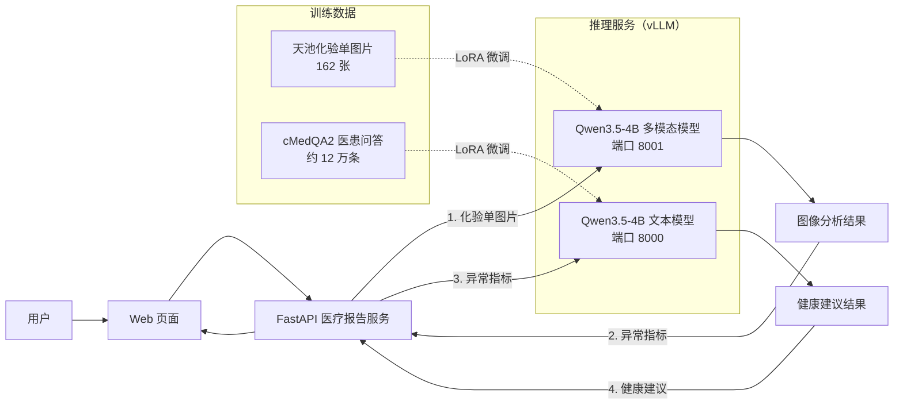

# PHM 私人健康管家：基于 Qwen3.5-4B 的医学报告解读与健康建议

## 项目概述

PHM（Personal Health Manager）是一个大模型微调与部署项目。以 Qwen3.5-4B 为基座，用 LoRA 分别微调了一个**多模态模型**（识别化验单中的异常指标）和一个**文本模型**（根据异常指标生成健康建议），用 vLLM 部署推理服务，并通过 FastAPI + Web 页面串成完整流程：上传化验单图片 → 识别异常指标 → 生成健康建议。



## 技术栈

| 环节 | 工具 |
|---|---|
| 基座模型 | Qwen3.5-4B |
| 微调 | Unsloth + LoRA（r=32），TRL SFTTrainer |
| 评估 | EvalScope（ROUGE / BLEU） |
| 推理部署 | vLLM 0.19（OpenAI 兼容接口） |
| 服务与前端 | FastAPI + 原生 HTML/CSS/JavaScript |
| 训练与部署硬件 | AutoDL：RTX 5090 32GB（训练、评估）、RTX PRO 6000 96GB（双模型部署） |

## 目录结构

```
phm-medical-llm/
├── 1-training/                          # 1-training: 模型训练与评估
│   ├── 1-prototype-image/         # 原型设计截图
│   ├── 2-prepare-dataset/        # 数据集准备
│   │   ├── prepare_dataset.py    # 原始数据集处理
│   │   ├── convert_to_evalscope_format.py
│   │   └── split_dataset.py      # 数据集划分
│   ├── 3-eval-llm/               # LLM 模型评估
│   │   ├── 1-eval/               # EvalScope 评估
│   │   ├── 2-vllm/               # vLLM 推理服务
│   │   └── 3-app/                # 评估结果查看
│   ├── 4-train-llm/              # LLM 微调训练
│   ├── 5-train-vl/               # VL 多模态微调训练
│   └── 6-vllm-vl/                # VL 模型验证
│
└── 2-serving/                          # 2-serving: 服务部署与应用
    ├── 1-launch-vllm/            # vLLM 服务启动脚本
    ├── 2-validation/             # 模型验证
    │   └── test-img/             # 测试图像
    └── 3-service/                # 医学检测报告解读服务
        ├── v1/                   # 基础文件上传版本
        ├── v2/                   # Base64 图像传输版本
        ├── v3/                   # vLLM 集成版本
        └── v4/                   # 完整 Web UI 版本
```

## 核心功能

### 1. 医学报告图像分析 (VL 模型)

输入医学检测报告图像，自动识别异常指标：

```
输入: 医学检测报告图片
    │
    ▼
VL 模型分析图像
    │
    ▼
输出: "检测到以下异常指标：..." 
```

### 2. 健康问答 (LLM 模型)

基于 cMedQA2 医患问答数据微调健康相关问题：

```
输入: "我肚子疼是怎么回事？"
    │
    ▼
LLM 健康顾问
    │
    ▼
输出: "根据您描述的症状，可能的原因包括..."
```

### 3. 完整分析流程

结合 VL 和 LLM 模型，提供完整的健康分析服务：

1. 用户上传医学报告图片
2. VL 模型识别异常指标
3. LLM 基于异常指标生成健康建议
4. 返回完整的分析报告

## 微调效果

### 文本模型（cMedQA2 测试集，256 条）

| 指标 | 微调前 | 微调后 | 变化 |
|---|---|---|---|
| ROUGE-L-F | 0.0178 | **0.1529** | ↑ 约 8.6 倍 |
| ROUGE-L-P | 0.0092 | 0.1752 | ↑ 约 19 倍 |
| ROUGE-L-R | 0.3930 | 0.1922 | ↓（回答变短，覆盖面减小） |
| ROUGE-1-F | 0.0496 | 0.2041 | ↑ 约 4.1 倍 |
| BLEU-1 | 0.0088 | 0.1406 | ↑ 约 16 倍 |
| 平均输出长度 | 2838 tokens | 1098 tokens | ↓ 61% |
| 平均响应时间 | 27.8 s | 12.0 s | ↓ 57% |

原始模型会先输出大段思考过程，平均近 3000 个 token，召回率高但精确率不到 1%；微调后学会了像医生一样简短作答。

训练配置：3000 步，有效 batch 16（约 0.5 个 epoch），RTX 5090 上耗时 4 小时 9 分，loss 从 4.1 降到 2.0 左右。

### 多模态模型（化验单图片，162 张）

训练 3 个 epoch（33 步），RTX 5090 上耗时 4 分 22 秒，loss 从 1.76 降到 0.09。课程原配置训练 16 个 epoch，loss 降到 0.0003，有明显过拟合，因此改为 3 个 epoch。

## 项目中遇到的问题与解决

### 1. 发现并修复数据泄露

预处理脚本用 `set` 合并问答，Python 字符串哈希每次运行都是随机的，所以每次生成的数据顺序不同。第一次生成的测试集，和我第二次重新生成的训练集来自两次不同的切分，导致评估用的 256 道题里有 **212 道（83%）** 出现在训练集中。改为使用同一次切分得到的训练集和测试集，重新跑基线，确认重叠为 0。

### 2. 修复对话模板错误

Unsloth 的 `apply_chat_template` 在未指定模板时默认使用 **Llama 3 格式**（`<|start_header_id|>`、`<|eot_id|>`），而 Qwen 使用 ChatML 格式（`<|im_start|>`、`<|im_end|>`）。训练和推理格式不一致，导致课程演示的回答末尾出现 `<|eot_id|>` 乱码。改为按 Qwen 官方模板构造训练文本（包含空的 `<think></think>`），微调后的输出不再出现该问题。

### 3. 评估提速 14.5 倍

评估客户端串行发送请求，最初参数配置 vLLM `--max-num-seqs` 为 2，256 条预计需要 66 分钟。根据 vLLM 日志中的 KV Cache 容量，把服务端并发和客户端 `eval_batch_size` 都调到 32，评估时间降到 **4 分 33 秒**，整体吞吐量从约 157 tok/s 提升到约 2700 tok/s，ROUGE 分数几乎不变。

### 4. 双模型部署的显存分配

在 32GB 的 RTX 5090 上同时部署两个模型时，多模态模型启动失败，日志显示可用 KV Cache 为 −0.01 GB。根据两次失败的缺口，反推出两个模型的权重加预热峰值合计约 27GB，接近显存上限。最终迁移到 96GB 的 RTX PRO 6000，两个服务各占 45% 显存。

## 微调后模型下载（已上传到ModelScope）

| 模型 | 地址 |
|---|---|
| 文本模型 | <ModelScope 链接> |
| 多模态模型 | <ModelScope 链接> |


## 免责声明

- 本项目为大模型微调与部署的学习实践，模型输出**不构成任何医疗建议**，不能替代专业医生的诊断。
- 模型在识别和判断上可能出错，训练数据来自公开数据集 cMedQA2 和阿里云天池化验单数据集，部分标注存在错误。

